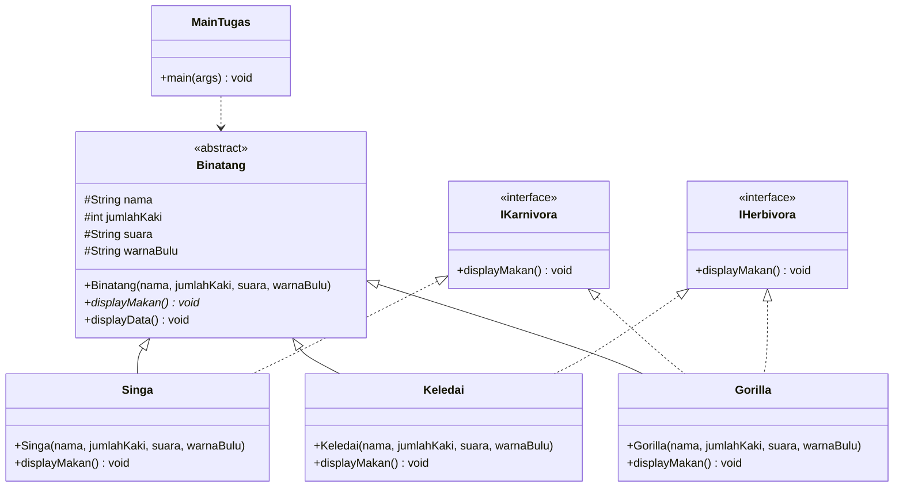

# LAPORAN JOBSHEET 10 — ABSTRACT CLASS DAN INTERFACE

## Identitas

- **Nama** : Muhammad Ferdi Afiyanto
- **NIM** : 254107020122
- **Kelas** : 2G
- **Mata Kuliah** : Praktikum Pemrograman Berbasis Objek
- **Pertemuan** : 10
- **Materi** : Abstract Class, Interface, dan Multiple Interface

> Catatan: berkas PDF acuan bernama `Jobsheet 9 - Abstract Class dan Interface`, padahal
> materinya adalah pertemuan 10. Laporan dan folder proyek ini memakai penomoran yang benar,
> yaitu **Jobsheet 10**.

---

# 1. Tujuan

1. Menjelaskan maksud dan tujuan penggunaan abstract class dan interface.
2. Menerapkan abstract class di dalam pembuatan program.
3. Menerapkan interface dan multiple interface di dalam pembuatan program.
4. Membedakan kapan menggunakan abstract class dan kapan menggunakan interface.

# 2. Dasar Teori Singkat

### Abstract class

Abstract class adalah class yang tidak dapat diinstansiasi dengan `new`, tetapi dapat
di-*extend*. Abstract class baru bermanfaat setelah ada class turunan yang melengkapinya.
Karakteristiknya:

- Boleh memiliki atribut, constructor, dan method biasa.
- Boleh memiliki method tanpa badan (*abstract method*). Class yang memiliki minimal satu
  abstract method **wajib** dideklarasikan `abstract`.
- Class turunan yang konkret wajib meng-*override* semua abstract method induknya.

Abstract class dipakai untuk menyatakan hubungan **"adalah"** (*is-a*) pada hal yang masih
umum, misalnya `Hewan`: semua hewan bergerak, tetapi cara bergeraknya baru jelas setelah
jenis hewannya diketahui (`Kucing` berjalan dengan kaki, `Ikan` berenang dengan sirip).

### Interface

Interface adalah kontrak berisi daftar method yang harus dipenuhi class pemakainya.
Karakteristiknya:

- Dideklarasikan dengan `interface` dan dipakai melalui `implements`.
- Method di dalam interface otomatis `public abstract` (boleh tidak ditulis). Sejak Java 8
  interface juga boleh memiliki `default` dan `static` method berbadan.
- Hanya boleh memiliki konstanta (otomatis `public static final`), bukan variabel biasa.
- Tidak memiliki constructor dan tidak dapat dibuat objeknya dengan `new`.
- Pada jobsheet ini nama interface diawali huruf `I` (misalnya `ICumlaude`) sebagai kebiasaan
  penamaan, bukan aturan wajib Java.

Interface menyatakan hubungan **"dapat/bisa"** (*can-do*): seorang `Sarjana` **adalah**
`Mahasiswa`, tetapi ia **dapat** menjadi Cumlaude bila memenuhi kontrak `ICumlaude`.

### Multiple interface

Sebuah class hanya boleh meng-*extend* satu class, tetapi boleh meng-*implements* lebih dari
satu interface dengan pemisah koma. Inilah pengganti *multiple inheritance* di Java. Bila dua
interface memiliki method dengan signature sama, satu implementasi saja sudah memenuhi
keduanya.

Aturan yang sering menimbulkan error:

- Method implementasi interface pada class harus `public`.
- Nama, jumlah, dan tipe parameter harus sama persis dengan deklarasi interface.
- Method dan konstanta interface tidak boleh `private` atau `protected` (kecuali `private`
  untuk *helper method* berbadan sejak Java 9).
- Interface dan abstract class tidak dapat diinstansiasi dengan `new`.

### Perbedaan abstract class dan interface

| Abstract Class | Interface |
|---|---|
| Boleh berisi abstract method dan method biasa | Berisi abstract method (sejak Java 8 juga `default`/`static`) |
| Modifier method ditulis sendiri | Method otomatis `public abstract` |
| Boleh memiliki atribut instance dan konstanta | Hanya konstanta (`public static final`) |
| Boleh memiliki constructor | Tidak memiliki constructor |
| Satu class hanya boleh meng-extend satu class | Satu class boleh meng-implements banyak interface |
| Dapat meng-implements satu atau lebih interface | Dapat meng-extend interface lain, tidak meng-implements |
| Hubungan "adalah" (*is-a*) | Hubungan "dapat" (*can-do*) |

### Notasi UML

- **Abstract class**: nama class dan abstract method ditulis miring (boleh ditambah
  keterangan `«abstract»`).
- **Interface**: diberi notasi `«interface»` di atas nama.
- **Extends**: garis penuh dengan kepala panah segitiga kosong menuju class induk.
- **Implements**: garis putus-putus dengan kepala panah segitiga kosong menuju interface.

---

# 3. Struktur Package

```text
Jobsheet10/
├── src/id/ac/polinema/abstrakinterface/
│   ├── abstractclass/     # Percobaan 1
│   ├── interfacelatihan/  # Percobaan 2 dan 3
│   └── tugas/             # Tugas
├── out/                   # output tiap percobaan + pesan error
├── laporan.md
└── README.md
```

Contoh kode pada PDF memakai package `abstractclass`, `interfacelatihan`, dan `tugas`.
Ketiganya diletakkan di bawah `id.ac.polinema.abstrakinterface.*` mengikuti konvensi
Jobsheet 7 dan 9, sehingga proyek dapat dibuka sebagai satu source tree tanpa error
*package mismatch*.

Kompilasi dan eksekusi:

```bash
cd Jobsheet10
mkdir -p build
javac -d build $(find src -name "*.java")

java -cp build id.ac.polinema.abstrakinterface.abstractclass.Program
java -cp build id.ac.polinema.abstrakinterface.interfacelatihan.Program
java -cp build id.ac.polinema.abstrakinterface.interfacelatihan.ProgramMawapres
java -cp build id.ac.polinema.abstrakinterface.tugas.MainTugas
```

Seluruh output tersimpan di `out/`, sedangkan pesan error seluruh eksperimen tersimpan di
`out/pesan-error.txt`. Proyek diuji dengan OpenJDK 27 (`javac 27`).

---

# 4. Percobaan 1 — Abstract Class

## 4.1 Kode Program

### `abstractclass/Hewan.java`

```java
package id.ac.polinema.abstrakinterface.abstractclass;

public abstract class Hewan {
    protected int umur;

    protected Hewan() {
        this.umur = 0;
    }

    public void bertambahUmur() {
        this.umur += 1;
    }

    public abstract void bergerak();
}
```

### `abstractclass/Kucing.java`

```java
package id.ac.polinema.abstrakinterface.abstractclass;

public class Kucing extends Hewan {
    @Override
    public void bergerak() {
        System.out.println("Berjalan dengan KAKI, \"tap..tap..\"");
    }
}
```

### `abstractclass/Ikan.java`

```java
package id.ac.polinema.abstrakinterface.abstractclass;

public class Ikan extends Hewan {
    @Override
    public void bergerak() {
        System.out.println("Berenang dengan SIRIP, \"wush..wush..\"");
    }
}
```

### `abstractclass/Orang.java`

```java
package id.ac.polinema.abstrakinterface.abstractclass;

public class Orang {
    private String nama;
    private Hewan hewanPeliharaan;

    public Orang(String nama) {
        this.nama = nama;
    }

    public void peliharaHewan(Hewan hewan) {
        this.hewanPeliharaan = hewan;
    }

    public void ajakPeliharaanJalanJalan() {
        System.out.println("Namaku " + this.nama);
        System.out.println("Hewan peliharaanku berjalan dengan cara: ");
        this.hewanPeliharaan.bergerak();
        System.out.println("----------------------------------------");
    }
}
```

### `abstractclass/Program.java`

```java
package id.ac.polinema.abstrakinterface.abstractclass;

public class Program {
    public static void main(String[] args) {
        Kucing kucingKampung = new Kucing();
        Ikan lumbaLumba = new Ikan();

        Orang ani = new Orang("Ani");
        Orang budi = new Orang("Budi");

        ani.peliharaHewan(kucingKampung);
        budi.peliharaHewan(lumbaLumba);

        ani.ajakPeliharaanJalanJalan();
        budi.ajakPeliharaanJalanJalan();
    }
}
```

## 4.2 Output

```text
Namaku Ani
Hewan peliharaanku berjalan dengan cara: 
Berjalan dengan KAKI, "tap..tap.."
----------------------------------------
Namaku Budi
Hewan peliharaanku berjalan dengan cara: 
Berenang dengan SIRIP, "wush..wush.."
----------------------------------------
```

## 4.3 Jawaban Pertanyaan Percobaan 1

### 1. Jelaskan jalannya program. Mengapa `this.hewanPeliharaan.bergerak()` di class `Orang` menghasilkan output berbeda untuk Ani dan Budi?

Program membuat dua objek hewan, yaitu `Kucing` dan `Ikan`, lalu dua objek `Orang`
("Ani" dan "Budi"). `ani.peliharaHewan(kucingKampung)` menyimpan objek `Kucing` ke atribut
`hewanPeliharaan` milik Ani, dan `budi.peliharaHewan(lumbaLumba)` menyimpan objek `Ikan` ke
atribut milik Budi.

Atribut `hewanPeliharaan` bertipe `Hewan` (abstract class), sehingga dapat menunjuk objek
`Kucing` maupun `Ikan` karena keduanya turunan `Hewan`. Saat
`this.hewanPeliharaan.bergerak()` dipanggil, compiler hanya memeriksa bahwa `Hewan` memiliki
method `bergerak()`. Implementasi yang dijalankan ditentukan JVM berdasarkan objek sebenarnya
(*virtual method invocation* / *dynamic method dispatch*):

| Pemanggilan | Objek yang ditunjuk | `bergerak()` yang dijalankan |
|---|---|---|
| `ani.ajakPeliharaanJalanJalan()` | `Kucing` | `Kucing.bergerak()` → "Berjalan dengan KAKI" |
| `budi.ajakPeliharaanJalanJalan()` | `Ikan` | `Ikan.bergerak()` → "Berenang dengan SIRIP" |

Karena itu satu method `Orang` dapat melayani hewan apa pun tanpa mengetahui jenis konkretnya,
dan outputnya berbeda sesuai objek yang dipelihara.

### 2. Tambahkan `Hewan hewan = new Hewan();` pada `main()`. Tunjukkan hasil kompilasinya dan jelaskan.

Hasil kompilasi:

```text
src/id/ac/polinema/abstrakinterface/abstractclass/Program.java:5: error: Hewan is abstract; cannot be instantiated
        Hewan hewan = new Hewan();
                      ^
1 error
```

Compiler menolak karena `Hewan` dideklarasikan `abstract`. Abstract class memang tidak boleh
dibuat objeknya dengan `new`, walaupun ia memiliki constructor (constructor tersebut hanya
dipanggil melalui `super()` dari subclass). Objek hanya boleh dibuat dari class turunan yang
konkret, misalnya `new Kucing()`.

### 3. Bolehkah class yang meng-extend abstract class tidak mengimplementasikan abstract method induknya? Buktikan dengan menghapus `bergerak()` dari `Ikan`.

Tidak boleh, kecuali class tersebut juga dideklarasikan `abstract`. Setelah `bergerak()`
dihapus, isi `Ikan` menjadi:

```java
public class Ikan extends Hewan {}
```

Hasil kompilasi:

```text
src/id/ac/polinema/abstrakinterface/abstractclass/Ikan.java:3: error: Ikan is not abstract and does not override abstract method bergerak() in Hewan
public class Ikan extends Hewan {}
       ^
1 error
```

Aturannya: class konkret (bukan abstract) wajib mengimplementasikan **semua** abstract method
yang diwarisi. Jika `Ikan` ingin tetap tanpa `bergerak()`, ia harus ditulis
`public abstract class Ikan extends Hewan`, tetapi akibatnya `new Ikan()` di `Program` juga
gagal dikompilasi.

### 4. Tambahkan `public abstract void bernapas();` di dalam class `Ikan` tanpa mengubah deklarasi class. Tunjukkan hasil kompilasinya dan jelaskan aturan yang dilanggar.

Hasil kompilasi:

```text
src/id/ac/polinema/abstrakinterface/abstractclass/Ikan.java:3: error: Ikan is not abstract and does not override abstract method bernapas() in Ikan
public class Ikan extends Hewan {
       ^
1 error
```

Aturan yang dilanggar: **class yang memiliki minimal satu abstract method wajib
dideklarasikan sebagai abstract class**. Deklarasi `Ikan` tetap `public class Ikan`, padahal
`bernapas()` tidak memiliki badan, sehingga `Ikan` dianggap belum lengkap. Selain itu, abstract
method baru tersebut juga harus diimplementasikan oleh subclass konkret `Ikan` sendiri
(seperti disebut pada pesan error: *does not override abstract method bernapas() in Ikan*).
Perbaikannya: tulis `public abstract class Ikan extends Hewan` dan beri badan pada
`bernapas()` di subclass, atau langsung isi method `bernapas()`.

---

# 5. Percobaan 2 — Interface

## 5.1 Kode Program

### `interfacelatihan/ICumlaude.java`

```java
package id.ac.polinema.abstrakinterface.interfacelatihan;

public interface ICumlaude {
    public abstract void lulus();

    public abstract void meraihIPKTinggi();
}
```

### `interfacelatihan/Mahasiswa.java`

```java
package id.ac.polinema.abstrakinterface.interfacelatihan;

public class Mahasiswa {
    protected String nama;

    public Mahasiswa(String nama) {
        this.nama = nama;
    }

    public void kuliahDiKampus() {
        System.out.println("Aku mahasiswa, namaku " + this.nama);
        System.out.println("Aku berkuliah di kampus.");
    }
}
```

### `interfacelatihan/Sarjana.java`

```java
package id.ac.polinema.abstrakinterface.interfacelatihan;

public class Sarjana extends Mahasiswa implements ICumlaude {
    public Sarjana(String nama) {
        super(nama);
    }

    @Override
    public void lulus() {
        System.out.println("Aku sudah menyelesaikan SKRIPSI");
    }

    @Override
    public void meraihIPKTinggi() {
        System.out.println("IPK-ku lebih dari 3,51");
    }
}
```

Pada tahap Percobaan 2, `Sarjana` hanya meng-implements `ICumlaude`. `IBerprestasi` baru
ditambahkan pada Percobaan 3 (soal 3), sehingga kode final `Sarjana` memuat dua interface.
Kode finalnya ditampilkan pada bagian 6.1.

### `interfacelatihan/PascaSarjana.java`

```java
package id.ac.polinema.abstrakinterface.interfacelatihan;

public class PascaSarjana extends Mahasiswa implements ICumlaude {
    public PascaSarjana(String nama) {
        super(nama);
    }

    @Override
    public void lulus() {
        System.out.println("Aku sudah menyelesaikan TESIS");
    }

    @Override
    public void meraihIPKTinggi() {
        System.out.println("IPK-ku lebih dari 3,71");
    }
}
```

### `interfacelatihan/Rektor.java`

```java
package id.ac.polinema.abstrakinterface.interfacelatihan;

public class Rektor {
    public void beriSertifikatCumlaude(ICumlaude mahasiswaCumlaude) {
        System.out.println("Saya REKTOR, memberikan sertifikat cumlaude.");
        System.out.println("Selamat! Silakan perkenalkan diri Anda..");

        mahasiswaCumlaude.lulus();
        mahasiswaCumlaude.meraihIPKTinggi();

        System.out.println("----------------------------------------");
    }
}
```

Method `beriSertifikatMawapres()` ditambahkan pada Percobaan 3 (lihat bagian 6.1).

### `interfacelatihan/Program.java` (setelah diperbaiki)

```java
package id.ac.polinema.abstrakinterface.interfacelatihan;

public class Program {
    public static void main(String[] args) {
        Rektor pakRektor = new Rektor();

        Sarjana sarjanaCumlaude = new Sarjana("Dini");
        PascaSarjana masterCumlaude = new PascaSarjana("Elok");

        pakRektor.beriSertifikatCumlaude(sarjanaCumlaude);
        pakRektor.beriSertifikatCumlaude(masterCumlaude);
    }
}
```

## 5.2 Error Langkah 6 dan Perbaikannya

Versi PDF pada langkah 6 masih mengirim `mhsBiasa`:

```java
Mahasiswa mhsBiasa = new Mahasiswa("Charlie");
Sarjana sarjanaCumlaude = new Sarjana("Dini");
PascaSarjana masterCumlaude = new PascaSarjana("Elok");

pakRektor.beriSertifikatCumlaude(mhsBiasa);        // error
pakRektor.beriSertifikatCumlaude(sarjanaCumlaude);
pakRektor.beriSertifikatCumlaude(masterCumlaude);
```

Hasil kompilasi:

```text
src/id/ac/polinema/abstrakinterface/interfacelatihan/Program.java:11: error: incompatible types: Mahasiswa cannot be converted to ICumlaude
        pakRektor.beriSertifikatCumlaude(mhsBiasa);
                                         ^
Note: Some messages have been simplified; recompile with -Xdiags:verbose to get full output
1 error
```

Perbaikan: `Mahasiswa` biasa tidak memenuhi kontrak `ICumlaude`, sehingga variabel `mhsBiasa`
dan pemanggilannya dihapus. Program hanya memberi sertifikat kepada objek yang
meng-implements `ICumlaude`, yaitu `Sarjana` dan `PascaSarjana`.

## 5.3 Output

```text
Saya REKTOR, memberikan sertifikat cumlaude.
Selamat! Silakan perkenalkan diri Anda..
Aku sudah menyelesaikan SKRIPSI
IPK-ku lebih dari 3,51
----------------------------------------
Saya REKTOR, memberikan sertifikat cumlaude.
Selamat! Silakan perkenalkan diri Anda..
Aku sudah menyelesaikan TESIS
IPK-ku lebih dari 3,71
----------------------------------------
```

## 5.4 Jawaban Pertanyaan Percobaan 2

### 1. Mengapa pada langkah 7 terjadi error? Tuliskan pesan error dan jelaskan perbaikannya.

Error terjadi karena `pakRektor.beriSertifikatCumlaude(mhsBiasa)` mengirim objek `Mahasiswa`
ke parameter bertipe `ICumlaude`:

```text
incompatible types: Mahasiswa cannot be converted to ICumlaude
```

`Mahasiswa` adalah class biasa yang **tidak** meng-implements `ICumlaude`, sehingga tidak
memiliki `lulus()` dan `meraihIPKTinggi()` dan bukan bentuk dari `ICumlaude`. Interface
menuntut relasi *is-a* yang eksplisit melalui `implements`. Perbaikannya adalah menghapus
pemanggilan untuk `mhsBiasa` (beserta variabelnya), sehingga hanya `Sarjana` dan
`PascaSarjana` yang menerima sertifikat sesuai output yang diminta.

### 2. Dapatkah method `kuliahDiKampus()` dipanggil dari objek `sarjanaCumlaude` di class `Program`? Mengapa?

Bisa. `sarjanaCumlaude` dideklarasikan sebagai `Sarjana`, dan `Sarjana extends Mahasiswa`.
Method `kuliahDiKampus()` diwarisi dari `Mahasiswa`, sehingga termasuk anggota yang dikenali
compiler pada tipe `Sarjana`:

```java
Sarjana sarjanaCumlaude = new Sarjana("Dini");
sarjanaCumlaude.kuliahDiKampus();      // valid
```

### 3. Dapatkah `kuliahDiKampus()` dipanggil dari parameter `mahasiswaCumlaude` pada method `beriSertifikatCumlaude()` di class `Rektor`? Mengapa?

Tidak bisa langsung. Parameter tersebut bertipe `ICumlaude`, dan interface itu hanya
mendeklarasikan `lulus()` serta `meraihIPKTinggi()`. Method `kuliahDiKampus()` bukan anggota
`ICumlaude`, sehingga compiler menolak dengan `cannot find symbol`. Untuk memanggilnya perlu
*downcast* yang dijaga `instanceof`:

```java
if (mahasiswaCumlaude instanceof Mahasiswa) {
    ((Mahasiswa) mahasiswaCumlaude).kuliahDiKampus();
}
```

`Rektor` sengaja hanya bergantung pada kontrak `ICumlaude` agar dapat menerima implementor
apa pun tanpa mengetahui class konkretnya.

### 4. Hapus kata kunci `public` pada method `lulus()` di class `Sarjana`. Tunjukkan hasil kompilasinya dan jelaskan.

Hasil kompilasi:

```text
src/id/ac/polinema/abstrakinterface/interfacelatihan/Sarjana.java:9: error: lulus() in Sarjana cannot implement lulus() in ICumlaude
    void lulus() {
         ^
  attempting to assign weaker access privileges; was public
1 error
```

Method di interface otomatis `public abstract`. Implementasinya tidak boleh menurunkan
visibilitas menjadi *package-private* (`void lulus()`), karena itu berarti method tidak dapat
diakses dari luar package `interfacelatihan` dan kontrak interface tidak terpenuhi. Aturan
overriding: hak akses implementasi harus **sama atau lebih luas**. Perbaikannya adalah
mengembalikan `public void lulus()`.

---

# 6. Percobaan 3 — Multiple Interface

## 6.1 Kode Program

### `interfacelatihan/IBerprestasi.java`

```java
package id.ac.polinema.abstrakinterface.interfacelatihan;

public interface IBerprestasi {
    public abstract void menjuaraiKompetisi();

    public abstract void membuatPublikasiIlmiah();
}
```

### `interfacelatihan/Sarjana.java` (setelah soal 3)

```java
package id.ac.polinema.abstrakinterface.interfacelatihan;

public class Sarjana extends Mahasiswa implements ICumlaude, IBerprestasi {
    public Sarjana(String nama) {
        super(nama);
    }

    @Override
    public void lulus() {
        System.out.println("Aku sudah menyelesaikan SKRIPSI");
    }

    @Override
    public void meraihIPKTinggi() {
        System.out.println("IPK-ku lebih dari 3,51");
    }

    @Override
    public void menjuaraiKompetisi() {
        System.out.println("Saya telah menjuarai kompetisi NASIONAL");
    }

    @Override
    public void membuatPublikasiIlmiah() {
        System.out.println("Saya menerbitkan artikel di jurnal NASIONAL");
    }
}
```

### `interfacelatihan/PascaSarjana.java`

```java
package id.ac.polinema.abstrakinterface.interfacelatihan;

public class PascaSarjana extends Mahasiswa implements ICumlaude, IBerprestasi {
    public PascaSarjana(String nama) {
        super(nama);
    }

    @Override
    public void lulus() {
        System.out.println("Aku sudah menyelesaikan TESIS");
    }

    @Override
    public void meraihIPKTinggi() {
        System.out.println("IPK-ku lebih dari 3,71");
    }

    @Override
    public void menjuaraiKompetisi() {
        System.out.println("Saya telah menjuarai kompetisi INTERNASIONAL");
    }

    @Override
    public void membuatPublikasiIlmiah() {
        System.out.println("Saya menerbitkan artikel di jurnal INTERNASIONAL");
    }
}
```

### `interfacelatihan/Rektor.java`

```java
package id.ac.polinema.abstrakinterface.interfacelatihan;

public class Rektor {
    public void beriSertifikatCumlaude(ICumlaude mahasiswaCumlaude) {
        System.out.println("Saya REKTOR, memberikan sertifikat cumlaude.");
        System.out.println("Selamat! Silakan perkenalkan diri Anda..");

        mahasiswaCumlaude.lulus();
        mahasiswaCumlaude.meraihIPKTinggi();

        System.out.println("----------------------------------------");
    }

    public void beriSertifikatMawapres(IBerprestasi mahasiswaBerprestasi) {
        System.out.println("Saya REKTOR, memberikan sertifikat MAWAPRES.");
        System.out.println("Selamat! Bagaimana Anda bisa berprestasi?");

        mahasiswaBerprestasi.menjuaraiKompetisi();
        mahasiswaBerprestasi.membuatPublikasiIlmiah();

        System.out.println("----------------------------------------");
    }
}
```

### `interfacelatihan/ProgramMawapres.java`

```java
package id.ac.polinema.abstrakinterface.interfacelatihan;

public class ProgramMawapres {
    public static void main(String[] args) {
        Rektor pakRektor = new Rektor();

        Sarjana sarjanaCumlaude = new Sarjana("Dini");
        PascaSarjana masterCumlaude = new PascaSarjana("Elok");

        // pakRektor.beriSertifikatCumlaude(sarjanaCumlaude);
        // pakRektor.beriSertifikatCumlaude(masterCumlaude);

        pakRektor.beriSertifikatMawapres(sarjanaCumlaude);
        pakRektor.beriSertifikatMawapres(masterCumlaude);
    }
}
```

`Program.java` (Percobaan 2) tetap dipertahankan agar output Percobaan 2 dapat dijalankan
ulang. Karena keduanya memakai class `Program`/`ProgramMawapres` pada package yang sama,
driver Percobaan 3 diberi nama `ProgramMawapres`. `Rektor` dipakai bersama oleh keduanya.

## 6.2 Error Langkah 4 dan Perbaikannya

Sebelum soal 3 dikerjakan, `Sarjana` hanya `implements ICumlaude`, sedangkan `main` sudah
memanggil `beriSertifikatMawapres(sarjanaCumlaude)`:

```text
src/id/ac/polinema/abstrakinterface/interfacelatihan/ProgramMawapres.java:13: error: incompatible types: Sarjana cannot be converted to IBerprestasi
        pakRektor.beriSertifikatMawapres(sarjanaCumlaude);
                                         ^
Note: Some messages have been simplified; recompile with -Xdiags:verbose to get full output
1 error
```

Perbaikan sementara (langkah 5) adalah mengomentari pemanggilan untuk `sarjanaCumlaude`,
sehingga dihasilkan output satu blok seperti yang diminta jobsheet:

```text
Saya REKTOR, memberikan sertifikat MAWAPRES.
Selamat! Bagaimana Anda bisa berprestasi?
Saya telah menjuarai kompetisi INTERNASIONAL
Saya menerbitkan artikel di jurnal INTERNASIONAL
----------------------------------------
```

Perbaikan sesungguhnya dikerjakan pada soal 3: `Sarjana` ditambahkan `implements IBerprestasi`
beserta kedua method-nya (versi NASIONAL), sehingga kedua pemanggilan sah dan program
menghasilkan dua blok.

## 6.3 Output Final (Soal 3)

```text
Saya REKTOR, memberikan sertifikat MAWAPRES.
Selamat! Bagaimana Anda bisa berprestasi?
Saya telah menjuarai kompetisi NASIONAL
Saya menerbitkan artikel di jurnal NASIONAL
----------------------------------------
Saya REKTOR, memberikan sertifikat MAWAPRES.
Selamat! Bagaimana Anda bisa berprestasi?
Saya telah menjuarai kompetisi INTERNASIONAL
Saya menerbitkan artikel di jurnal INTERNASIONAL
----------------------------------------
```

## 6.4 Jawaban Pertanyaan Percobaan 3

### 1. Pada interface `IBerprestasi`, ganti modifier `menjuaraiKompetisi()` menjadi `protected` dan `membuatPublikasiIlmiah()` menjadi `private`. Apa yang terjadi? Jelaskan alasannya.

Hasil kompilasi:

```text
src/id/ac/polinema/abstrakinterface/interfacelatihan/IBerprestasi.java:4: error: modifier protected not allowed here
    protected abstract void menjuaraiKompetisi();
                            ^
src/id/ac/polinema/abstrakinterface/interfacelatihan/IBerprestasi.java:6: error: illegal combination of modifiers: abstract and private
    private abstract void membuatPublikasiIlmiah();
                          ^
src/id/ac/polinema/abstrakinterface/interfacelatihan/Rektor.java:19: error: membuatPublikasiIlmiah() has private access in IBerprestasi
        mahasiswaBerprestasi.membuatPublikasiIlmiah();
                            ^
src/id/ac/polinema/abstrakinterface/interfacelatihan/PascaSarjana.java:23: error: membuatPublikasiIlmiah() in PascaSarjana does not override or implement a method from a supertype
    @Override
    ^
src/id/ac/polinema/abstrakinterface/interfacelatihan/Sarjana.java:23: error: membuatPublikasiIlmiah() in Sarjana does not override or implement a method from a supertype
    @Override
    ^
5 errors
```

Alasan:

- Anggota interface secara implisit `public`. `protected` tidak diizinkan karena tidak ada
  konsep pewarisan terbatas pada interface, sehingga compiler menolak dengan
  *modifier protected not allowed here*.
- `private abstract` mustahil: method abstract harus diimplementasikan class lain, sedangkan
  `private` membuatnya tidak terlihat. Compiler menyebut
  *illegal combination of modifiers: abstract and private*.
- Karena `membuatPublikasiIlmiah()` tidak lagi menjadi bagian kontrak, implementasi di
  `Sarjana` dan `PascaSarjana` tidak meng-override apa pun, dan pemanggilan di `Rektor`
  menjadi tidak dapat diakses.

Modifier dikembalikan menjadi `public abstract` seperti semula.

### 2. Tambahkan `IBerprestasi prestasi = new IBerprestasi();` pada `main()`. Mengapa baris tersebut error?

Hasil kompilasi:

```text
src/id/ac/polinema/abstrakinterface/interfacelatihan/ProgramMawapres.java:13: error: IBerprestasi is abstract; cannot be instantiated
        IBerprestasi prestasi = new IBerprestasi();
                                ^
1 error
```

Interface adalah kontrak murni: tidak memiliki constructor dan method-nya belum berbadan.
Karena itu interface tidak dapat diinstansiasi. Objek harus dibuat dari class yang
meng-implements-nya, misalnya `new Sarjana("Dini")`, lalu referensi `IBerprestasi` boleh
menunjuk objek tersebut (*upcasting*):

```java
IBerprestasi prestasi = new PascaSarjana("Elok");   // valid
```

### 3. Apabila Sarjana Berprestasi harus menjuarai kompetisi NASIONAL dan menerbitkan artikel di jurnal NASIONAL, modifikasilah class-class terkait agar `pakRektor` dapat memberikan sertifikat mawapres kepada `sarjanaCumlaude`.

Perubahan yang dilakukan: deklarasi `Sarjana` diubah menjadi

```java
public class Sarjana extends Mahasiswa implements ICumlaude, IBerprestasi {

    @Override
    public void menjuaraiKompetisi() {
        System.out.println("Saya telah menjuarai kompetisi NASIONAL");
    }

    @Override
    public void membuatPublikasiIlmiah() {
        System.out.println("Saya menerbitkan artikel di jurnal NASIONAL");
    }
}
```

`PascaSarjana` tetap memakai versi INTERNASIONAL, dan `ProgramMawapres` memanggil
`beriSertifikatMawapres()` untuk kedua objek. Outputnya persis seperti yang diminta:

```text
Saya REKTOR, memberikan sertifikat MAWAPRES.
Selamat! Bagaimana Anda bisa berprestasi?
Saya telah menjuarai kompetisi NASIONAL
Saya menerbitkan artikel di jurnal NASIONAL
----------------------------------------
Saya REKTOR, memberikan sertifikat MAWAPRES.
Selamat! Bagaimana Anda bisa berprestasi?
Saya telah menjuarai kompetisi INTERNASIONAL
Saya menerbitkan artikel di jurnal INTERNASIONAL
----------------------------------------
```

Dengan begini `Sarjana` memenuhi dua kontrak sekaligus (`ICumlaude` dan `IBerprestasi`),
sesuai konsep *multiple interface*. Satu method `beriSertifikatMawapres(IBerprestasi)` di
`Rektor` dapat melayani dua class berbeda tanpa perubahan kode.

---

# 7. Tugas — Sistem Binatang

## 7.1 Deskripsi Kasus

Sistem mengidentifikasi karakteristik dan jenis makanan beberapa binatang:

- `Singa` hanya makan daging → **Karnivora**;
- `Keledai` hanya makan tumbuhan → **Herbivora**;
- `Gorilla` makan keduanya → **Karnivora + Herbivora** (omnivora);
- setiap binatang memiliki nama, suara, warna bulu, dan jumlah kaki.

`Binatang` adalah **abstract class** (hubungan "adalah"), sedangkan `IKarnivora` dan
`IHerbivora` adalah **interface** (hubungan "dapat"). `Gorilla` meng-implements keduanya.

## 7.2 UML Sistem



Keterangan notasi:

- `Binatang <|-- Singa` adalah garis **extends** (pewarisan) — `Singa` *adalah* `Binatang`.
- `IKarnivora <|.. Singa` adalah garis **implements** (putus-putus) — `Singa` *dapat*
  bersifat karnivora.
- `Gorilla` memiliki dua garis implements karena memenuhi dua interface sekaligus.

## 7.3 Kode Program

### `tugas/Binatang.java`

```java
package id.ac.polinema.abstrakinterface.tugas;

public abstract class Binatang {
    protected String nama;
    protected int jumlahKaki;
    protected String suara;
    protected String warnaBulu;

    public Binatang(String nama, int jumlahKaki, String suara, String warnaBulu) {
        this.nama = nama;
        this.jumlahKaki = jumlahKaki;
        this.suara = suara;
        this.warnaBulu = warnaBulu;
    }

    public abstract void displayMakan();

    public void displayData() {
        System.out.println("Nama: " + nama);
        System.out.println("Jumlah Kaki: " + jumlahKaki);
        System.out.println("Suara: " + suara);
        System.out.println("Warna Bulu: " + warnaBulu);
    }
}
```

### `tugas/IKarnivora.java`

```java
package id.ac.polinema.abstrakinterface.tugas;

public interface IKarnivora {
    public abstract void displayMakan();
}
```

### `tugas/IHerbivora.java`

```java
package id.ac.polinema.abstrakinterface.tugas;

public interface IHerbivora {
    public abstract void displayMakan();
}
```

### `tugas/Singa.java`

```java
package id.ac.polinema.abstrakinterface.tugas;

public class Singa extends Binatang implements IKarnivora {
    public Singa(String nama, int jumlahKaki, String suara, String warnaBulu) {
        super(nama, jumlahKaki, suara, warnaBulu);
    }

    @Override
    public void displayMakan() {
        System.out.println("Jenis: Karnivora");
        System.out.println("Makanan: Daging");
    }
}
```

### `tugas/Keledai.java`

```java
package id.ac.polinema.abstrakinterface.tugas;

public class Keledai extends Binatang implements IHerbivora {
    public Keledai(String nama, int jumlahKaki, String suara, String warnaBulu) {
        super(nama, jumlahKaki, suara, warnaBulu);
    }

    @Override
    public void displayMakan() {
        System.out.println("Jenis: Herbivora");
        System.out.println("Makanan: Tumbuhan");
    }
}
```

### `tugas/Gorilla.java`

```java
package id.ac.polinema.abstrakinterface.tugas;

public class Gorilla extends Binatang implements IKarnivora, IHerbivora {
    public Gorilla(String nama, int jumlahKaki, String suara, String warnaBulu) {
        super(nama, jumlahKaki, suara, warnaBulu);
    }

    // Satu implementasi cukup untuk memenuhi displayMakan() pada IKarnivora,
    // IHerbivora, dan abstract method milik Binatang (signature-nya sama).
    @Override
    public void displayMakan() {
        System.out.println("Jenis: Karnivora + Herbivora");
        System.out.println("Makanan: Daging + Tumbuhan");
    }
}
```

### `tugas/MainTugas.java`

```java
package id.ac.polinema.abstrakinterface.tugas;

public class MainTugas {
    public static void main(String[] args) {
        Binatang[] binatang = {
                new Keledai("Keledai", 4, "Hehehehe", "Abu-Abu"),
                new Gorilla("Gulali", 4, "Haaum Hauum", "Hitam Manis"),
                new Singa("CingaCing", 4, "Roaar Roaaar", "Coklat")
        };

        for (int i = 0; i < binatang.length; i++) {
            binatang[i].displayMakan();
            binatang[i].displayData();
            if (i < binatang.length - 1) {
                System.out.println();
            }
        }
    }
}
```

## 7.4 Output

```text
Jenis: Herbivora
Makanan: Tumbuhan
Nama: Keledai
Jumlah Kaki: 4
Suara: Hehehehe
Warna Bulu: Abu-Abu

Jenis: Karnivora + Herbivora
Makanan: Daging + Tumbuhan
Nama: Gulali
Jumlah Kaki: 4
Suara: Haaum Hauum
Warna Bulu: Hitam Manis

Jenis: Karnivora
Makanan: Daging
Nama: CingaCing
Jumlah Kaki: 4
Suara: Roaar Roaaar
Warna Bulu: Coklat
```

Output sudah sesuai dengan yang diminta jobsheet.

## 7.5 Penjelasan Implementasi

- **`Binatang` sebagai abstract class.** Atribut `nama`, `jumlahKaki`, `suara`, dan
  `warnaBulu` serta method `displayData()` adalah bagian yang sama untuk semua binatang,
  sehingga diletakkan di superclass. Method `displayMakan()` tidak dapat diisi di
  `Binatang` karena makanannya bergantung pada jenis binatang, sehingga dideklarasikan
  `abstract`.
- **`IKarnivora` dan `IHerbivora` sebagai interface.** Keduanya menyatakan kemampuan
  ("dapat") dan hanya berisi kontrak `displayMakan()`. `Singa` hanya memenuhi `IKarnivora`,
  `Keledai` hanya `IHerbivora`.
- **`Gorilla` multiple interface.** Karena `IKarnivora` dan `IHerbivora` mendeklarasikan
  method dengan signature identik, satu method `displayMakan()` sudah memenuhi keduanya
  sekaligus memenuhi abstract method dari `Binatang`. Tidak perlu menulis dua method.
- **Heterogeneous array `Binatang[]`.** `MainTugas` menyimpan ketiga objek dalam satu array
  bertipe `Binatang`. Saat `binatang[i].displayMakan()` dipanggil, JVM menjalankan override
  milik objek sebenarnya (*dynamic method dispatch*), sehingga satu perulangan dapat
  menampilkan tiga jenis makanan berbeda.
- **Pembagian tanggung jawab tipe.** `Binatang` dipakai karena ketiga class benar-benar
  *adalah* binatang (relasi *is-a*, berbagi state dan perilaku umum). Interface dipakai untuk
  sifat yang hanya dimiliki sebagian binatang (relasi *can-do*). Jika `IKarnivora` dibuat
  abstract class, `Gorilla` tidak dapat sekaligus menjadi herbivora karena Java tidak
  mendukung multiple inheritance class.

---

# 8. Kesimpulan

1. Abstract class adalah class yang tidak dapat diinstansiasi, tetapi dapat di-extend dan
   boleh memiliki atribut, constructor, method biasa, serta abstract method. Class konkret
   turunannya wajib mengimplementasikan seluruh abstract method induk.
2. Class yang memiliki minimal satu abstract method wajib dideklarasikan `abstract`.
   Abstract method baru harus diberi badan pada subclass konkret, bukan pada class
   non-abstract.
3. Interface adalah kontrak berisi method `public abstract` dan konstanta. Interface tidak
   memiliki constructor sehingga tidak dapat dibuat objeknya dengan `new`; objek harus
   berasal dari class yang meng-implements-nya.
4. Implementasi method interface wajib `public` dan signature-nya harus sama persis dengan
   deklarasi interface. Menurunkan visibilitas menghasilkan error
   *attempting to assign weaker access privileges*.
5. Multiple interface memungkinkan satu class memiliki beberapa kemampuan sekaligus
   (`PascaSarjana implements ICumlaude, IBerprestasi`) sebagai pengganti multiple
   inheritance. Bila signature method-nya sama, satu implementasi cukup memenuhi semuanya.
6. Abstract class dipakai untuk hubungan **"adalah"** yang berbagi state dan perilaku
   (`Kucing adalah Hewan`, `Singa adalah Binatang`), sedangkan interface dipakai untuk
   hubungan **"dapat"** yang bersifat kemampuan tambahan (`Sarjana dapat Cumlaude`,
   `Gorilla dapat menjadi karnivora dan herbivora`).
7. Abstract class maupun interface tidak dapat diinstansiasi. Upaya `new` pada keduanya
   menghasilkan error kompilasi *is abstract; cannot be instantiated*, dan upaya
   mengirim objek yang tidak memenuhi kontrak menghasilkan
   *incompatible types ... cannot be converted to ...*.
8. Kombinasi abstract class dan interface pada tugas menghasilkan struktur yang fleksibel:
   `Binatang[]` menyimpan objek berbeda jenis, dan pemanggilan method yang sama
   menghasilkan perilaku sesuai objek sebenarnya melalui *dynamic method dispatch*.
